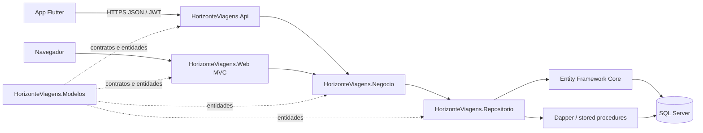
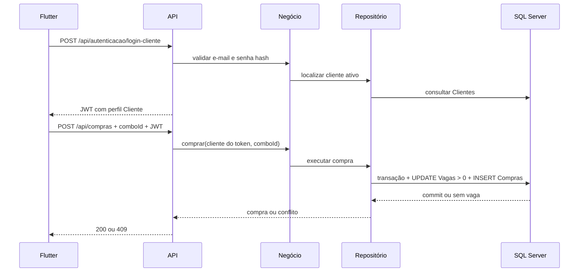

# Arquitetura Horizonte Viagens

Diagrama das camadas e do fluxo que o front-end Flutter usa para consultar combos, autenticar clientes e registrar compras. A API e a Web compartilham as mesmas regras de negócio e repositórios.

## Fluxo de compra

## Modelo de dados mapeado

O banco mapeia as 14 entidades/tabelas seguintes; o número de 12 citado no PDF parece ser uma contagem antiga e deve ser comparado ao diagrama oficial do grupo antes de remover estruturas:

| Tabela | Relação principal |
|---|---|
| Clientes | possui telefones; pode realizar compras |
| Administradores | acompanha compras e possui telefones |
| TelefonesClientes | pertence a um cliente |
| TelefonesAdministradores | pertence a um administrador |
| Hoteis | possui telefones e reservas de quarto |
| TelefonesHoteis | pertence a um hotel |
| Voos | possui passagens |
| Passagens | pertence a voo e participa de item de combo |
| ReservasQuartos | pertence a hotel e participa de item de combo |
| Passeios | participa de item de combo |
| Combos | possui itens, compras e estoque de vagas |
| ItensCombos | liga combo, passagem, quarto e passeio |
| Compras | liga cliente e combo com preço registrado |
| MonitoramentosCompras | associa administrador e compra acompanhada |

## Rotas para integração

- `GET /api/combos?destino=...`: vitrine pública, pesquisa pela procedure parametrizada `sp_Combos_BuscarPorDestino`.
- `POST /api/autenticacao/login-cliente`: emite token de cliente.
- `POST /api/compras`: aceita `comboId`; o cliente vem do token. A compra baixa uma vaga atomicamente.
- `GET /api/compras`: lista para administradores.
- `POST /api/compras/{id}/monitoramento`: registra acompanhamento administrativo.

O modelo mantém `Viagem`, `PacoteEconomico` e `PacoteLuxo` no domínio, enquanto `Combo` é a entidade persistida de catálogo. A relação conceitual final entre a hierarquia POO e as tabelas precisa seguir a decisão do grupo e seu diagrama relacional aprovado.
